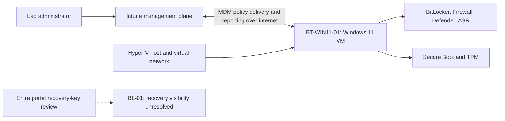

# Microsoft Intune Endpoint Security Hardening, Compliance Validation & Risk Assessment

**Windows 11 · Microsoft Intune · Hyper-V · PowerShell · Endpoint security · Risk assessment**

## Overview

This personal lab documents endpoint configuration, compliance validation, and risk assessment for **BT-WIN11-01**, a Windows 11 Hyper-V VM managed by Intune through **MDM-only enrollment**. The device is **not Microsoft Entra joined**.

The project distinguishes successful policy deployment, independent local verification, and compliance evaluation. All six evaluated compliance controls reported Compliant, while recovery-key visibility and ASR audit review remained unresolved. Compliance status does not resolve every operational risk.

Results are the author's supplied lab observations. Repository validation checks documentation and script syntax; it does not repeat endpoint testing. No screenshots or raw telemetry are published at this stage.

## Business scenario

A security team needs a managed Windows endpoint with encryption, host firewall protection, antimalware controls, and measurable compliance. Beyond deployment status, the team must evaluate recoverability, local administrator governance, and whether attack surface reduction rules audit or block activity.

## Architecture



MDM management does not establish Entra join. Centralized local group membership policy was **not deployed**, pending MDM-only compatibility review. See [architecture and trust boundaries](docs/ARCHITECTURE.md).

## Technology stack

| Technology | Role |
| --- | --- |
| Windows 11 / Hyper-V | Single virtual lab endpoint |
| Microsoft Intune | Endpoint security deployment and compliance evaluation |
| Microsoft Defender Antivirus / ASR | Antimalware settings and audit telemetry |
| BitLocker / TPM / Secure Boot | Encryption and platform state |
| Windows Defender Firewall | Host firewall profile settings |
| PowerShell | Independent read-only verification |
| NIST SP 800-53 Rev. 5 | Contextual security control mapping |

## Methodology

1. Establish enrollment scope and restore management connectivity.
2. Record policy configuration and per-device deployment outcomes separately.
3. Compare portal results with local PowerShell observations.
4. Assess recovery-key visibility, local accounts, and ASR audit telemetry.
5. Document findings, remediation recommendations, closure criteria, and untested areas.

Initial sync failed with `0x80072ee7` after VM internet connectivity was lost. Connectivity was restored; sync succeeded **November 15, 2026 at 9:46 AM**, and Intune check-in updated. The supplied timestamp's displayed time zone was not specified. No security incident is inferred from the connectivity failure.

See [implementation and validation procedures](docs/IMPLEMENTATION.md).

## Results matrix

“Not established” means the supplied observations do not establish that stage; it does not mean failure.

| Control | Configured / scope | Deployment | Locally verified | Intune compliance | Finding / untested |
| --- | --- | --- | --- | --- | --- |
| Management | MDM-only; not Entra joined | Sync recovered; check-in updated | VM internet restored | Not an evaluated control | Enrollment migration untested |
| BitLocker | C: encrypted; Intune encryption settings not supplied | Encryption policy deployment not established | FullyEncrypted, 100%, Protection On, XtsAes128; TPM and RecoveryPassword protector types | Compliant | **BL-01 OPEN**; recovery exercise untested |
| Firewall | All profiles enabled; inbound Block; outbound Allow; log blocked True | Intune firewall policy succeeded | Domain/Private/Public and listed settings verified | Compliant | Traffic behavior tests not supplied |
| Local accounts | Built-in Administrator disabled; BTLabAdmin in Administrators | Centralized membership policy **not deployed** | PasswordRequired False → True, remediated locally | Not an evaluated control | Password strength and central enforcement untested |
| Defender AV | Preferences below | Intune AV policy succeeded | AV, antispyware, real-time protection True; preferences verified | Antivirus and Antispyware Compliant | Malware challenge testing not supplied |
| Secure Boot | Platform state | Intune deployment not established | True | Compliant | Boot tamper testing not supplied |
| TPM | Platform state | Intune deployment not established | Present, ready, enabled, activated True | Compliant | Recovery testing not supplied |
| ASR / CFA | 18 rules: 1 Block, 17 Audit; Controlled Folder Access Audit | Intune ASR policy succeeded | Rule distribution and 10 recorded Event ID 1122 audit events | Not an evaluated control | **ASR-01 Under Review**; block-mode rollout untested |
| Network Protection | EnableNetworkProtection = 0, disabled | Deployment intent not established | Local preference verified | Not an evaluated control | No enablement or enforcement test claimed |

The six evaluated compliance controls were **BitLocker, Secure Boot, Firewall, TPM, Antivirus, and Antispyware**; all reported **Compliant**. This scoped Intune result is not certification or a full compliance assessment.

### Verified Defender preferences

| Preference | Observed value |
| --- | --- |
| MAPSReporting | 1 |
| CloudBlockLevel | 2 (High) |
| SubmitSamplesConsent | 1 |
| PUAProtection | 1 |
| DisableRealtimeMonitoring | False |
| DisableBehaviorMonitoring | False |
| DisableScriptScanning | False |
| DisableArchiveScanning | False |
| DisableIOAVProtection | False |
| EnableNetworkProtection | 0 (disabled) |

### ASR observations

The vulnerable signed driver rule, `56a863a9-875e-4185-98a7-b882c64b5ce5`, was the one Block rule. The other 17 rules were Audit. Controlled Folder Access was Audit.

Ten recorded Event ID **1122** events involved the LSASS credential protection rule, `9E6C4E1F-7D60-472F-BA1A-A39EF669E4B2`, and `svchost.exe` / `lsass.exe`. This is **audit telemetry, not proof of compromise**. No observation window or complete event corpus is supplied; the count is not a claim about all events on the endpoint.

## Security findings

| ID | Status | Observation | Next step |
| --- | --- | --- | --- |
| BL-01 | **OPEN** | No recovery key found in Entra portal | Verify a supported recovery/escrow workflow and authorized retrieval; do not infer absence everywhere |
| ASR-01 | **Under Review** | LSASS protection audit activity requires contextual review | Review legitimate behavior and compatibility before staged enforcement decisions |

See [evidence, impact, remediation, and closure criteria](docs/SECURITY_FINDINGS.md) and the [remediation tracker](remediation/README.md).

## Read-only verification

Run the [verification script](scripts/verify-endpoint-security.ps1) in **64-bit Windows PowerShell 5.1 as administrator on the lab endpoint**:

```powershell
.\scripts\verify-endpoint-security.ps1 | ConvertTo-Json -Depth 6
```

The script returns selected properties to the console. It does not change settings, write files, contact cloud services, or output recovery passwords, protector IDs, tenant IDs, or device IDs. BitLocker protector **types only** are projected. Local administrator names can identify users or domains: review output before sharing. Errors expose only a check name and exception type, not raw error text.

The JSON is displayed in the console, not saved or uploaded. The script cannot establish cloud escrow, Intune deployment, or compliance status. **Endpoint execution of this new script is not claimed**; previously supplied observations were not produced by it. Repository verification passed Windows PowerShell 5.1 syntax parsing, parsing of the six PowerShell examples, relative Markdown link/anchor checks, and whitespace checks. These are authoring checks, not endpoint security test results.

## Framework context

| NIST SP 800-53 Rev. 5 | Relevant project context |
| --- | --- |
| AC-2 — Account Management | Local administrator review and account property remediation |
| CM-6 — Configuration Settings | Documented settings and verification |
| SI-3 — Malicious Code Protection | Defender AV preferences |
| SI-4 — System Monitoring | ASR audit telemetry review |
| SC-28 — Protection of Information at Rest | BitLocker state and recovery considerations |

These mappings provide context only, not complete control implementation or a claim of NIST compliance.

## Limitations and lessons learned

- A single Hyper-V lab device is not a production deployment or representative fleet sample.
- MDM enrollment does not establish Entra join or compatibility with every identity-dependent policy.
- Successful deployment and Compliant status require separate local verification and risk review.
- Encryption does not demonstrate recoverability; portal visibility does not establish every recovery location.
- Audit telemetry does not demonstrate blocking or compromise.
- PasswordRequired True is a local property change, not proof of password strength or central policy enforcement.
- Network Protection remained disabled; no enabling change or additional finding is invented.
- No recovery exercise, malware execution, ASR block-mode rollout, Conditional Access enforcement, or production incident response is claimed.

## Documentation and evidence

| Resource | Contents |
| --- | --- |
| [Architecture](docs/ARCHITECTURE.md) | Trust boundaries and enrollment limitations |
| [Implementation](docs/IMPLEMENTATION.md) | Recorded configuration and validation procedures |
| [Security findings](docs/SECURITY_FINDINGS.md) | BL-01 and ASR-01 |
| [Evidence index](docs/EVIDENCE_INDEX.md) | Proposed filenames and screenshot locations |
| [Remediation tracker](remediation/README.md) | Status and closure requirements |
| [Evidence instructions](evidence/README.md) | Sanitization and publication requirements |

Evidence filenames are placeholders, not claims that images exist. Actual images can be added after sanitization; no screenshots have been fabricated.

## Technical references

- [Microsoft: Windows MDM enrollment](https://learn.microsoft.com/en-us/windows/client-management/mdm-enrollment-of-windows-devices).
- [Microsoft: ASR rule reference](https://learn.microsoft.com/en-us/defender-endpoint/attack-surface-reduction-rules-reference).
- [Microsoft: ASR events](https://learn.microsoft.com/en-us/defender-endpoint/attack-surface-reduction-windows-events), including Event ID 1122 audit activity.
- [NIST SP 800-53 Rev. 5](https://doi.org/10.6028/NIST.SP.800-53r5).

## Author

**Musah Issah** · Cybersecurity · Information Assurance · Governance, Risk & Compliance

[GitHub](https://github.com/MusahIssah)

*Educational lab. No recovery keys, passwords, tenant IDs, device IDs, sensitive raw logs, or backups are published.*
