# Implementation and Validation

[Overview](../README.md) · [Findings](SECURITY_FINDINGS.md) · [Evidence index](EVIDENCE_INDEX.md)

## Evidence model

Recorded work and repeat-verification procedures are separated below. Published screenshots and text exports now support the recorded observations. Policy names visible in the captures are lab labels; no assignment groups or unreported settings are inferred. Locate the matching Windows endpoint security or compliance policy in Intune and compare configuration, assignment, and per-device status. Portal navigation can change.

The commands are read-only procedures, not a claim that this exact sequence produced every supplied observation. Use elevated 64-bit Windows PowerShell on the lab endpoint; review output before sharing.

## 1. Enrollment and connectivity

Recorded: MDM-only enrollment, not Entra joined. Internet loss caused sync error `0x80072ee7`. Connectivity was restored; sync succeeded November 15, 2026 at 9:46 AM, and Intune check-in updated. The timestamp's source time zone and exact repair commands were not supplied.

For repeat validation, inspect the Windows work/school management connection, manually sync through Windows Settings, and compare its result with Intune check-in. Do not publish account or enrollment identifiers. Identity diagnostics can expose identifiers and are intentionally excluded from the collector.

### Supporting evidence

*Initial Intune device overview; historical check-in precedes sync recovery*

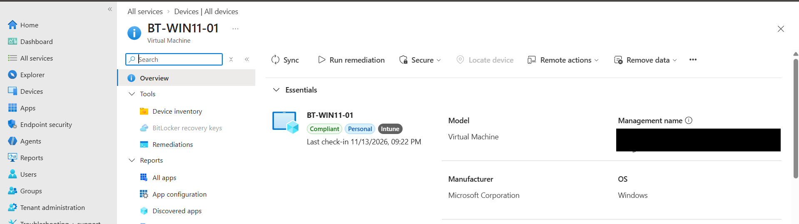

*Windows management connection lists Defender and Security policies*


*Sync failure 0x80072ee7 before connectivity restoration*

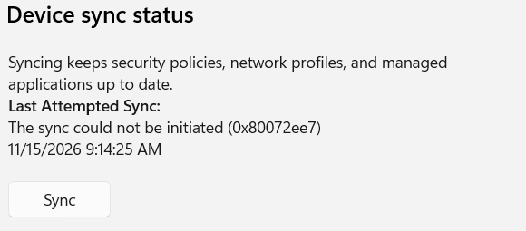

*Successful sync on November 15, 2026 at 9:46:23 AM*

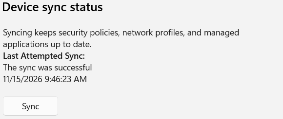

*Intune check-in updated to November 15, 2026 at 9:46 AM*

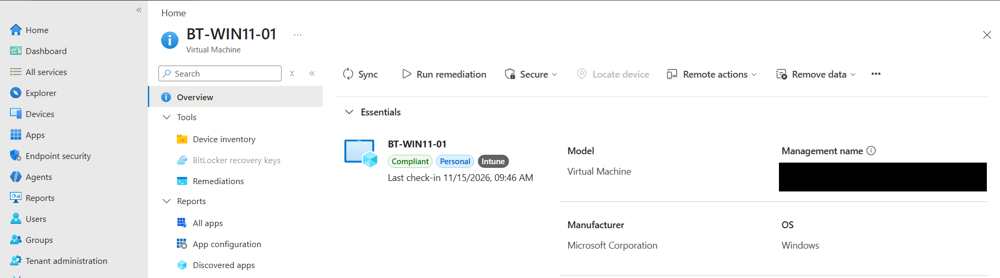

*Entra device properties show Intune MDM and a blank join-type field*

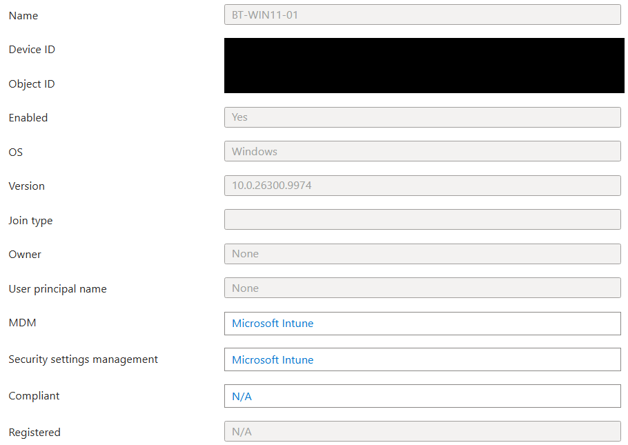

**Recorded output — [02_Windows11_Entra_Device_Status.txt](../evidence/02_Windows11_Entra_Device_Status.txt):**

```text
+----------------------------------------------------------------------+
| Device State                                                         |
+----------------------------------------------------------------------+

             AzureAdJoined : NO
          EnterpriseJoined : NO
              DomainJoined : NO
           Virtual Desktop : NOT SET
               Device Name : BT-WIN11-01

+----------------------------------------------------------------------+
| User State                                                           |
+----------------------------------------------------------------------+

                    NgcSet : NO
           WorkplaceJoined : NO
             WamDefaultSet : NO

+----------------------------------------------------------------------+
| SSO State                                                            |
+----------------------------------------------------------------------+

                AzureAdPrt : NO
       AzureAdPrtAuthority : NO
             EnterprisePrt : NO
    EnterprisePrtAuthority : NO

+----------------------------------------------------------------------+
| IE Proxy Config for Current User                                     |
+----------------------------------------------------------------------+

      Auto Detect Settings : YES
    Auto-Configuration URL :
         Proxy Server List :
         Proxy Bypass List :

+----------------------------------------------------------------------+
| WinHttp Default Proxy Config                                         |
+----------------------------------------------------------------------+

               Access Type : DIRECT

+----------------------------------------------------------------------+
| Ngc Prerequisite Check                                               |
+----------------------------------------------------------------------+

            IsDeviceJoined : NO
             IsUserAzureAD : NO
             PolicyEnabled : NO
          PostLogonEnabled : YES
            DeviceEligible : NO
        SessionIsNotRemote : NO
            CertEnrollment : none
              PreReqResult : WillNotProvision

For more information, please visit https://www.microsoft.com/aadjerrors
```

The Entra properties image has a blank join-type field and N/A compliance in that portal view; local AzureAdJoined NO is the direct join-state evidence. The six-control Intune result is shown separately below.

## 2. Firewall

Intune firewall policy deployment succeeded. Local Domain/Private/Public profiles were Enabled; inbound Block, outbound Allow, log blocked True.

```powershell
Get-NetFirewallProfile -PolicyStore ActiveStore |
    Select-Object Name, Enabled, DefaultInboundAction, DefaultOutboundAction, LogBlocked
```

Compare effective profiles with the device deployment status. Traffic behavior tests were not supplied.

### Supporting evidence

*Intune firewall policy reports one successful device*

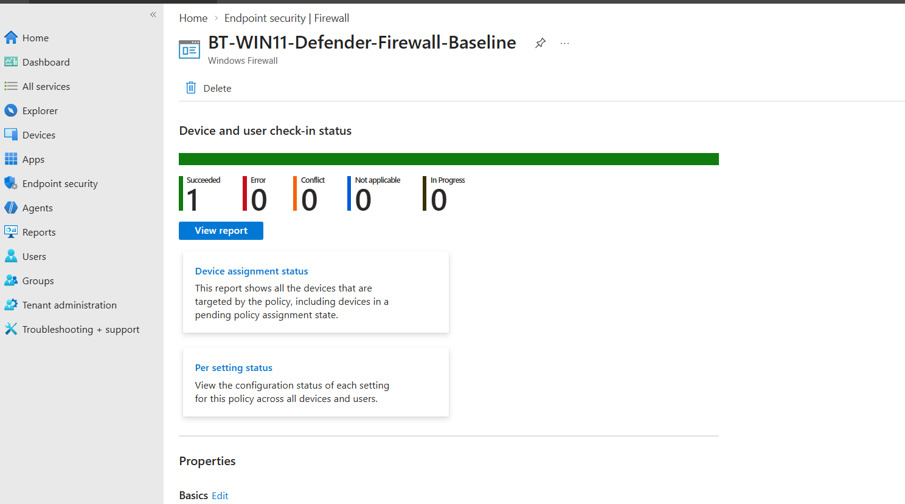

*Visible firewall per-setting deployment results succeeded*

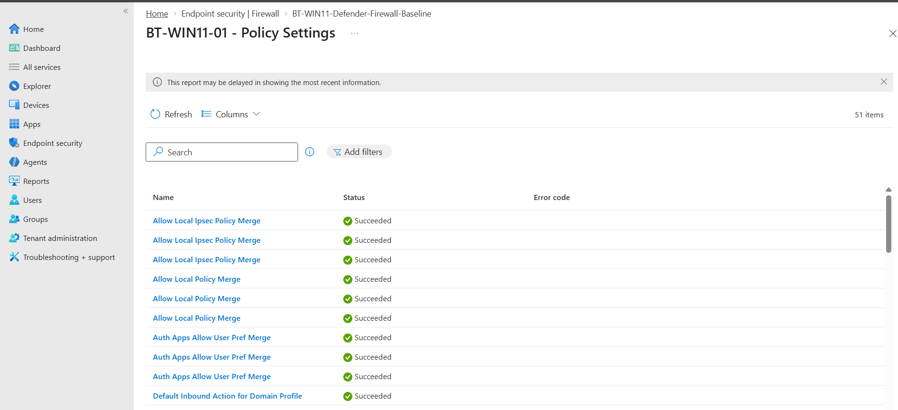

**Recorded output — [10_Defender_Firewall_Status.txt](../evidence/10_Defender_Firewall_Status.txt):**

```text
Firewall Assessment - 11/15/2026 10:52:08


Name                  : Domain
Enabled               : True
DefaultInboundAction  : Block
DefaultOutboundAction : Allow
LogAllowed            : False
LogBlocked            : True

Name                  : Private
Enabled               : True
DefaultInboundAction  : Block
DefaultOutboundAction : Allow
LogAllowed            : False
LogBlocked            : True

Name                  : Public
Enabled               : True
DefaultInboundAction  : Block
DefaultOutboundAction : Allow
LogAllowed            : False
LogBlocked            : True
```

## 3. BitLocker

C: was FullyEncrypted, 100%, Protection On, XtsAes128. TPM and RecoveryPassword protector types existed. No Intune encryption policy deployment result was supplied.

```powershell
$volume = Get-BitLockerVolume -MountPoint 'C:'
[pscustomobject]@{
    MountPoint = $volume.MountPoint
    VolumeStatus = [string]$volume.VolumeStatus
    EncryptionPercentage = $volume.EncryptionPercentage
    ProtectionStatus = [string]$volume.ProtectionStatus
    EncryptionMethod = [string]$volume.EncryptionMethod
    ProtectorTypes = @($volume.KeyProtector | ForEach-Object { [string]$_.KeyProtectorType })
}
```

Do not print complete volume or KeyProtector objects in public evidence. Do not retrieve recovery passwords for screenshots. No recovery key was found in Entra portal; [BL-01](SECURITY_FINDINGS.md#bl-01--recovery-key-visibility) remains open. Other locations are not excluded.

### Supporting evidence

**Recorded output — [06_BitLocker_Encryption_Status.txt](../evidence/06_BitLocker_Encryption_Status.txt):**

```text
MountPoint           : C:
VolumeStatus         : FullyEncrypted
ProtectionStatus     : On
EncryptionPercentage : 100
EncryptionMethod     : XtsAes128
```

**Recorded output — [07_BitLocker_Protector_Types.txt](../evidence/07_BitLocker_Protector_Types.txt):**

```text
KeyProtectorType
----------------
RecoveryPassword
             Tpm
```

*Portal reports no BitLocker recovery key found for the reviewed device*

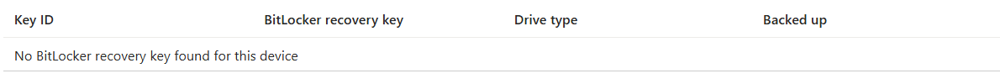

## 4. Local accounts

Built-in Administrator was disabled; BTLabAdmin belonged to Administrators. BTLabAdmin PasswordRequired was False and was remediated **locally** to True. The modifying command was not supplied and is not reconstructed here. Centralized membership policy was **not deployed**, pending MDM-only compatibility review.

Use SIDs for built-in identities to avoid localized display-name assumptions:

```powershell
Get-LocalUser |
    Where-Object { $_.SID.Value -match '-500$' -or $_.Name -eq 'BTLabAdmin' } |
    Select-Object Name, Enabled, PasswordRequired

Get-LocalGroupMember -SID 'S-1-5-32-544' |
    Select-Object Name, ObjectClass, PrincipalSource
```

Names can identify users or domains; sanitize before publication. PasswordRequired True does not prove strength, rotation, or central enforcement.

### Supporting evidence

*Historical local BTLabAdmin Password required No*

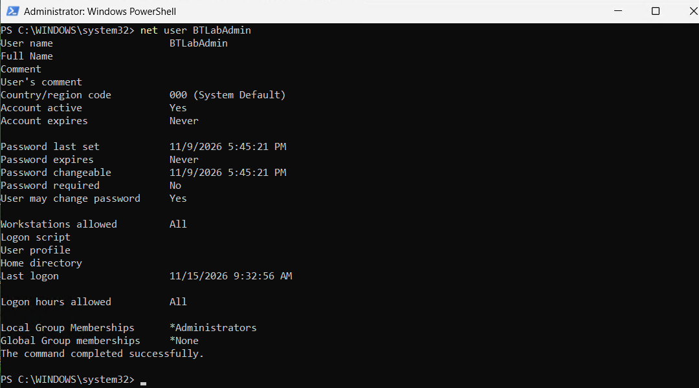

**Recorded output — [13_Local_Admin_Group_Membership.txt](../evidence/13_Local_Admin_Group_Membership.txt):**

```text
Name                      ObjectClass PrincipalSource
----                      ----------- ---------------
BT-WIN11-01\Administrator User                  Local
BT-WIN11-01\BTLabAdmin    User                  Local
```

**Recorded output — [14_Local_Admin_Account_Status.txt](../evidence/14_Local_Admin_Account_Status.txt):**

```text
Name          Enabled PasswordRequired PasswordLastSet
----          ------- ---------------- ---------------
Administrator   False             True
BTLabAdmin       True            False 11/9/2026 5:45:21 PM
```

**Recorded output — [16_Local_Admin_Password_Requirement_After.txt](../evidence/16_Local_Admin_Password_Requirement_After.txt):**

```text
User name                    BTLabAdmin
Full Name
Comment
User's comment
Country/region code          000 (System Default)
Account active               Yes
Account expires              Never

Password last set            11/9/2026 5:45:21 PM
Password expires             Never
Password changeable          11/9/2026 5:45:21 PM
Password required            Yes
User may change password     Yes

Workstations allowed         All
Logon script
User profile
Home directory
Last logon                   11/15/2026 9:32:56 AM

Logon hours allowed          All

Local Group Memberships      *Administrators
Global Group memberships     *None
The command completed successfully.
```

*Local user group membership profile selection; not deployment*

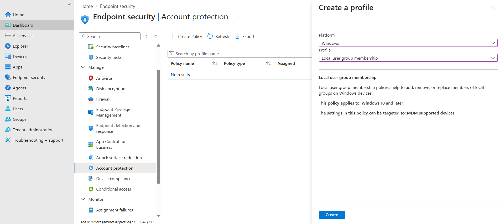

*Draft local administrator policy name and description*

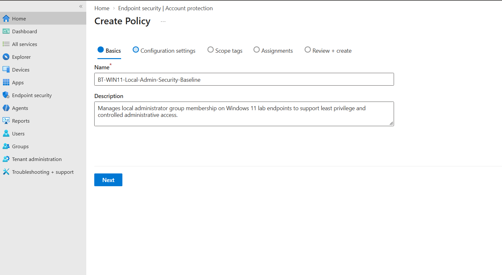

*Draft group configuration before values were added*

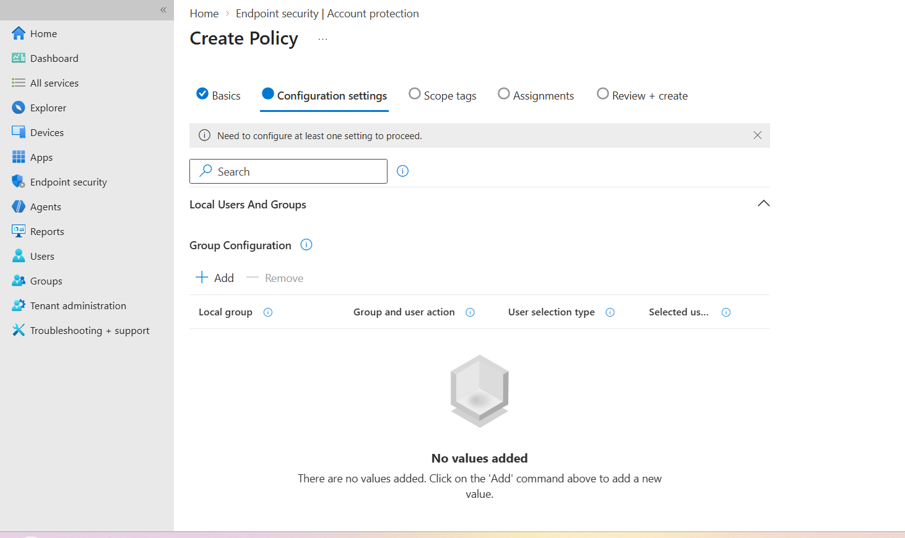

*Draft administrator group selection during compatibility review*

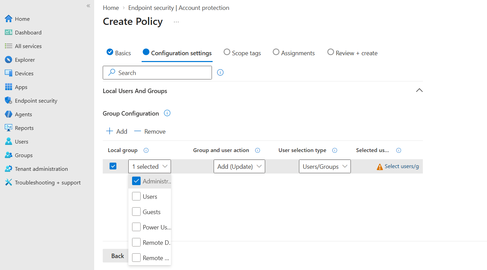

The four policy wizard captures document a draft and compatibility review only. They do not establish creation, assignment, or deployment. The password requirement change was local.

## 5. Compliance and platform security

The six Intune controls were BitLocker, Secure Boot, Firewall, TPM, Antivirus, and Antispyware; all reported Compliant. The captures below also show configuration context; disabled password fields are not evidence of enforced password requirements. No grace period is established.

```powershell
Confirm-SecureBootUEFI
Get-Tpm | Select-Object TpmPresent, TpmReady, TpmEnabled, TpmActivated
Get-MpComputerStatus |
    Select-Object AntivirusEnabled, AntispywareEnabled, RealTimeProtectionEnabled
```

Independent observations: Secure Boot True; all four TPM properties True; Defender AV, antispyware, and real-time protection True. Missing cmdlets, firmware support, or permissions are collection limitations, not automatic proof of noncompliance.

### Supporting evidence

*Compliance policy editing overview*

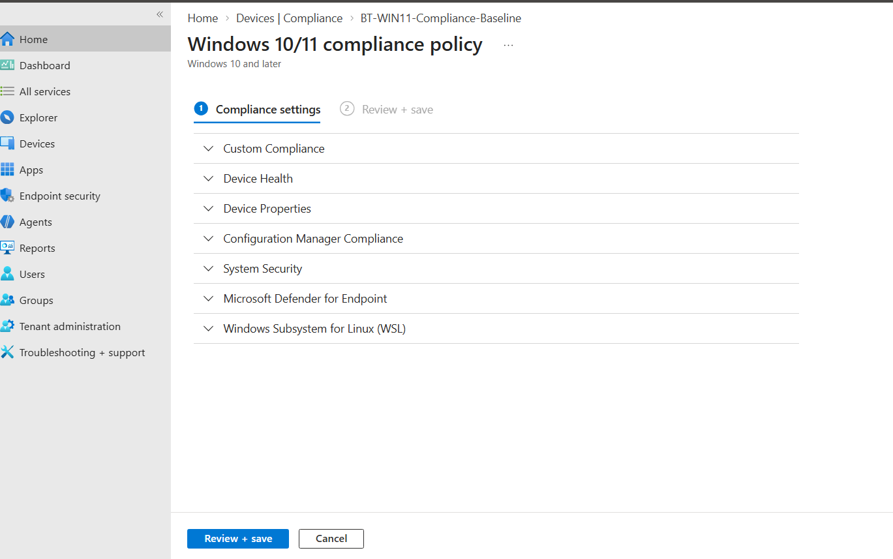

*BitLocker and Secure Boot selected as required*

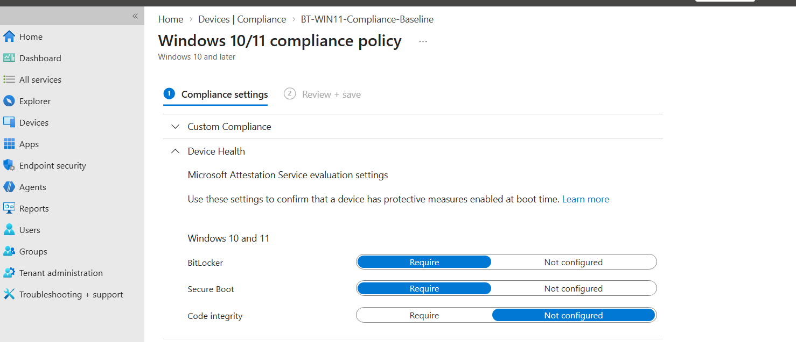

*Password settings shown as not configured; grey values are not enforcement evidence*

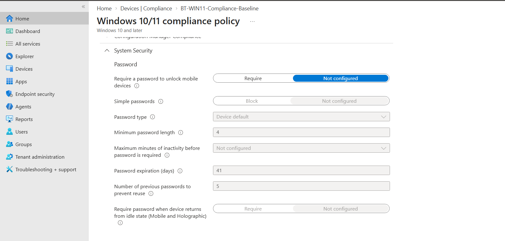

*Firewall, TPM, antivirus, and antispyware selected as required*

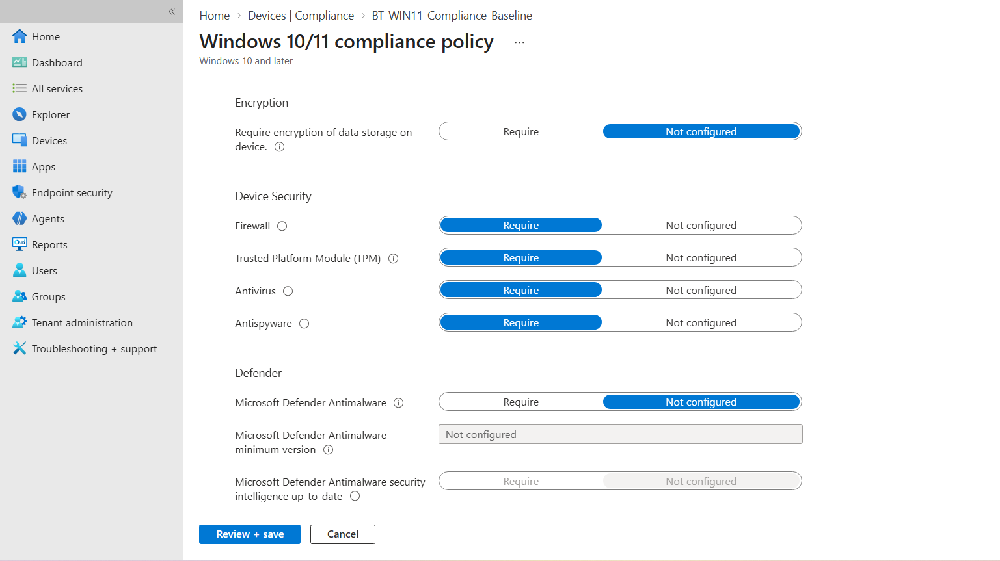

*All six evaluated controls reported Compliant*

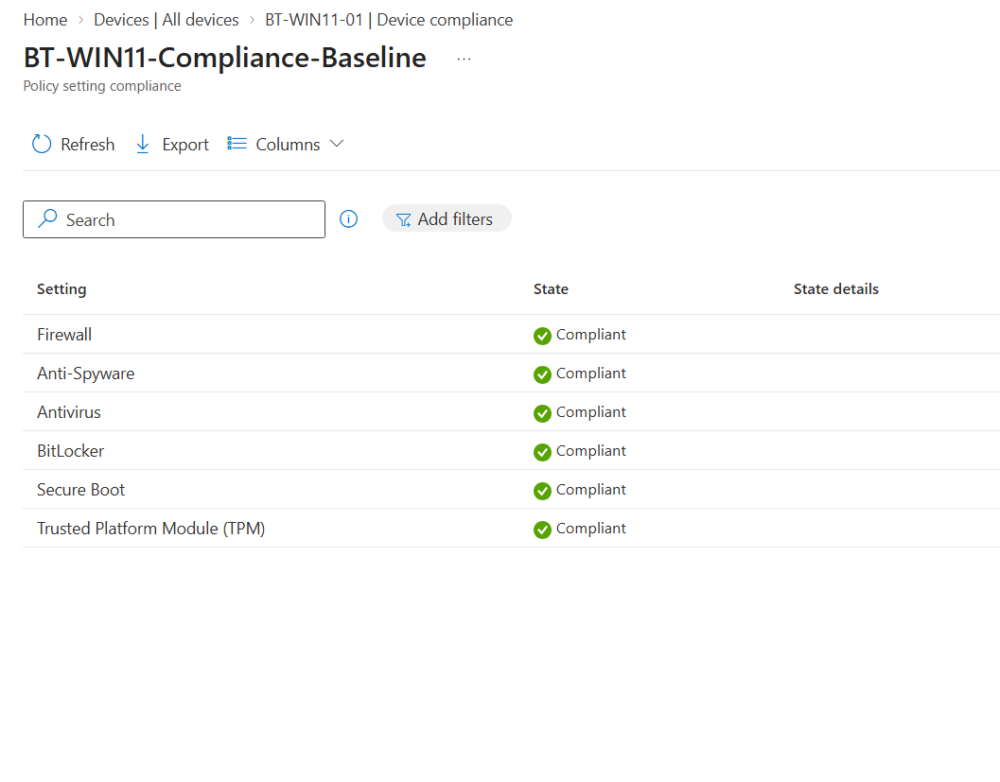

**Recorded output — [25_Device_Security_Compliance_Verification.txt](../evidence/25_Device_Security_Compliance_Verification.txt):**

```text
Device Security Verification - 11/15/2026 14:09:04
=== SECURE BOOT ===
True

=== TPM ===


TpmPresent   : True
TpmReady     : True
TpmEnabled   : True
TpmActivated : True


=== MICROSOFT DEFENDER ===


AMServiceEnabled              : True
AntivirusEnabled              : True
AntispywareEnabled            : True
RealTimeProtectionEnabled     : True
AntivirusSignatureLastUpdated : 11/13/2026 5:47:57 AM
```

## 6. Defender Antivirus

Intune AV policy deployed successfully. Compare local preferences with its device result:

```powershell
Get-MpPreference | Select-Object MAPSReporting, CloudBlockLevel, SubmitSamplesConsent,
    PUAProtection, DisableRealtimeMonitoring, DisableBehaviorMonitoring,
    DisableScriptScanning, DisableArchiveScanning, DisableIOAVProtection,
    EnableNetworkProtection
```

| Preference | Observed value |
| --- | --- |
| MAPSReporting | 1 |
| CloudBlockLevel | 2 (High) |
| SubmitSamplesConsent | 1 |
| PUAProtection | 1 |
| DisableRealtimeMonitoring | False |
| DisableBehaviorMonitoring | False |
| DisableScriptScanning | False |
| DisableArchiveScanning | False |
| DisableIOAVProtection | False |
| EnableNetworkProtection | 0 (disabled) |

No Network Protection enablement or malware challenge test is claimed.

### Supporting evidence

*Inventory of firewall, AV, and ASR configuration profiles*

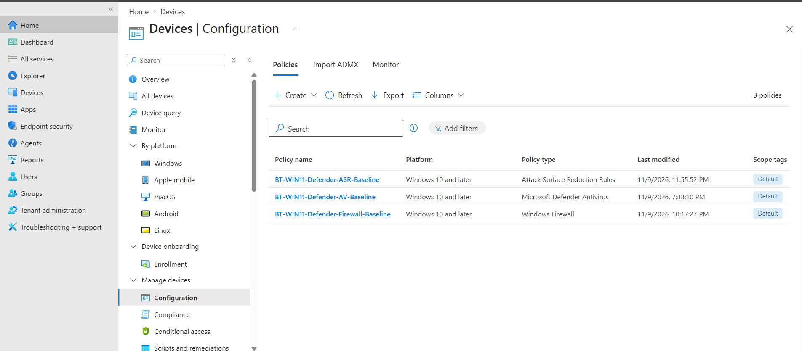

*Intune AV policy reports one successful device*

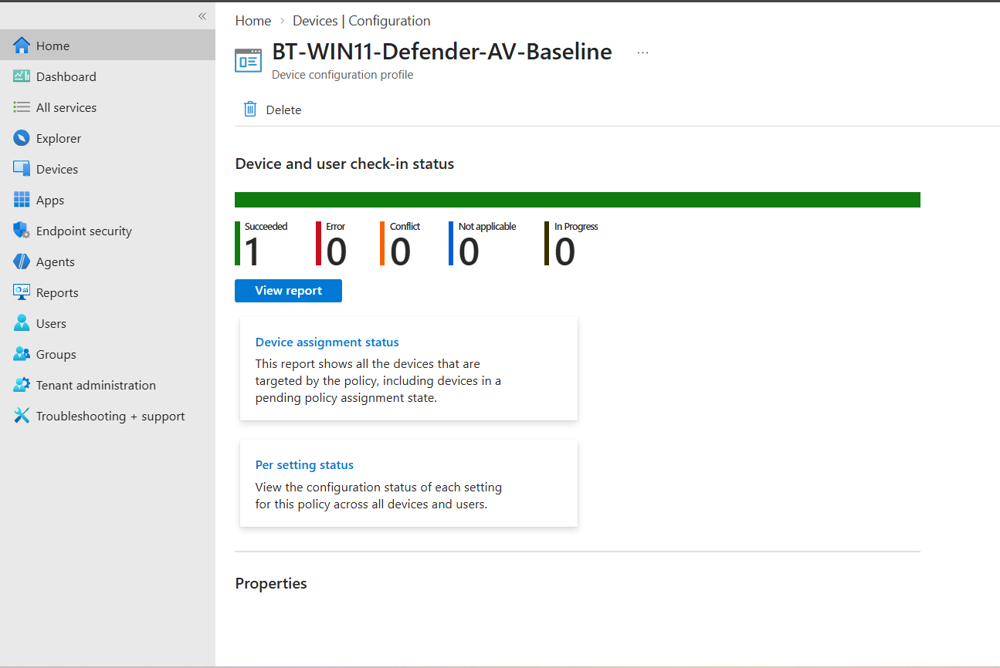

**Recorded output — [30_Defender_AV_Configuration_Verification.txt](../evidence/30_Defender_AV_Configuration_Verification.txt):**

```text
Defender Antivirus Verification - 11/15/2026 14:39:18


MAPSReporting             : 1
CloudBlockLevel           : 2
SubmitSamplesConsent      : 1
PUAProtection             : 1
DisableRealtimeMonitoring : False
DisableBehaviorMonitoring : False
DisableScriptScanning     : False
DisableArchiveScanning    : False
DisableIOAVProtection     : False
EnableNetworkProtection   : 0
```

## 7. ASR and Controlled Folder Access

Intune ASR policy deployed successfully. Local state: 18 rules, one Block and 17 Audit; Controlled Folder Access Audit. The Block rule was vulnerable signed drivers, `56a863a9-875e-4185-98a7-b882c64b5ce5`. The [collector](../scripts/verify-endpoint-security.ps1) pairs each returned rule ID and action by index. Do not infer the identities of unreported rules.

Ten recorded Event ID 1122 audit events involved LSASS protection rule `9E6C4E1F-7D60-472F-BA1A-A39EF669E4B2` and svchost.exe/lsass.exe. Review context locally in **Microsoft-Windows-Windows Defender/Operational**. Publish a sanitized summary only: event ID, rule ID, relevant executable basenames, count, and an observation window when available. No observation window was supplied for these ten events.

The collector intentionally excludes event logs and does not reconstruct this count. Audit telemetry is not proof of compromise. See [ASR-01](SECURITY_FINDINGS.md#asr-01--lsass-protection-audit-review).

### Supporting evidence

*Intune ASR policy reports one successful device*

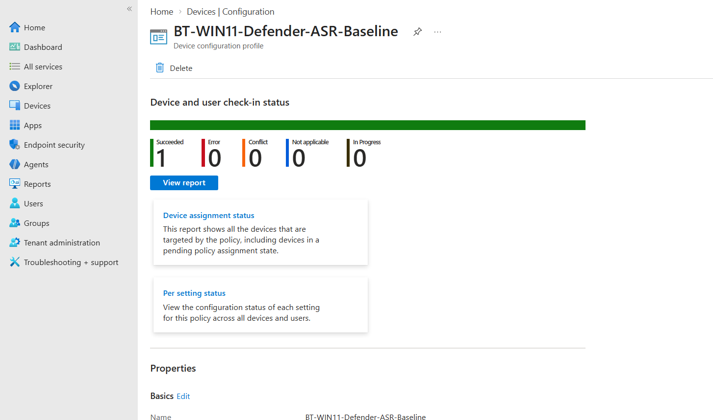

**Recorded output — [33_Defender_ASR_Configuration_Verification.txt](../evidence/33_Defender_ASR_Configuration_Verification.txt):**

```text
ASR Verification - 11/15/2026 15:02:36
01443614-cd74-433a-b99e-2ecdc07bfc25 : 2
26190899-1602-49e8-8b27-eb1d0a1ce869 : 2
33ddedf1-c6e0-47cb-833e-de6133960387 : 2
3B576869-A4EC-4529-8536-B80A7769E899 : 2
56a863a9-875e-4185-98a7-b882c64b5ce5 : 1
5BEB7EFE-FD9A-4556-801D-275E5FFC04CC : 2
75668C1F-73B5-4CF0-BB93-3ECF5CB7CC84 : 2
7674ba52-37eb-4a4f-a9a1-f0f9a1619a2c : 2
92E97FA1-2EDF-4476-BDD6-9DD0B4DDDC7B : 2
9e6c4e1f-7d60-472f-ba1a-a39ef669e4b2 : 2
b2b3f03d-6a65-4f7b-a9c7-1c7ef74a9ba4 : 2
BE9BA2D9-53EA-4CDC-84E5-9B1EEEE46550 : 2
c0033c00-d16d-4114-a5a0-dc9b3a7d2ceb : 2
c1db55ab-c21a-4637-bb3f-a12568109d35 : 2
d1e49aac-8f56-4280-b9ba-993a6d77406c : 2
D3E037E1-3EB8-44C8-A917-57927947596D : 2
D4F940AB-401B-4EFC-AADC-AD5F3C50688A : 2
e6db77e5-3df2-4cf1-b95a-636979351e5b : 2
Controlled Folder Access: 2
```

*Ten returned audit events; query was limited to the latest ten matches*

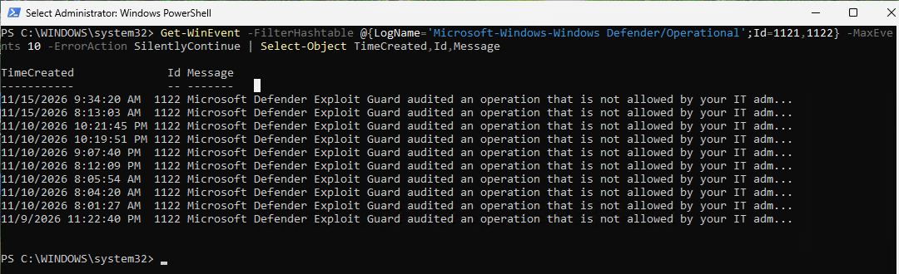

*Vulnerable signed drivers Block; Adobe Reader child processes Audit*

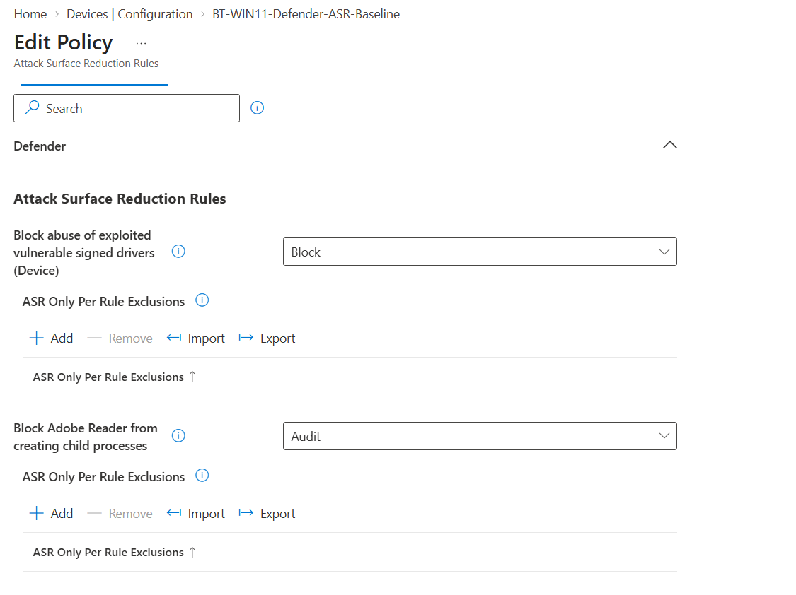

*LSASS credential protection shown in Audit mode*

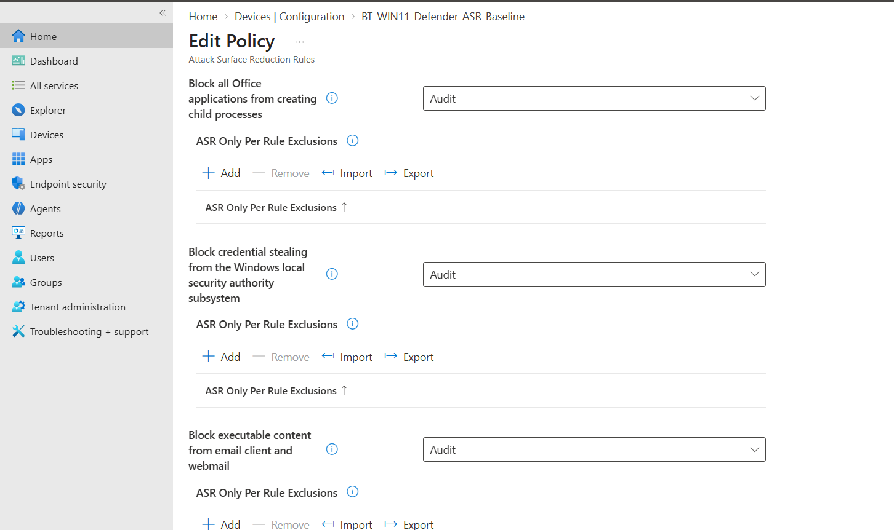

*Executable reputation and obfuscated script rules in Audit*

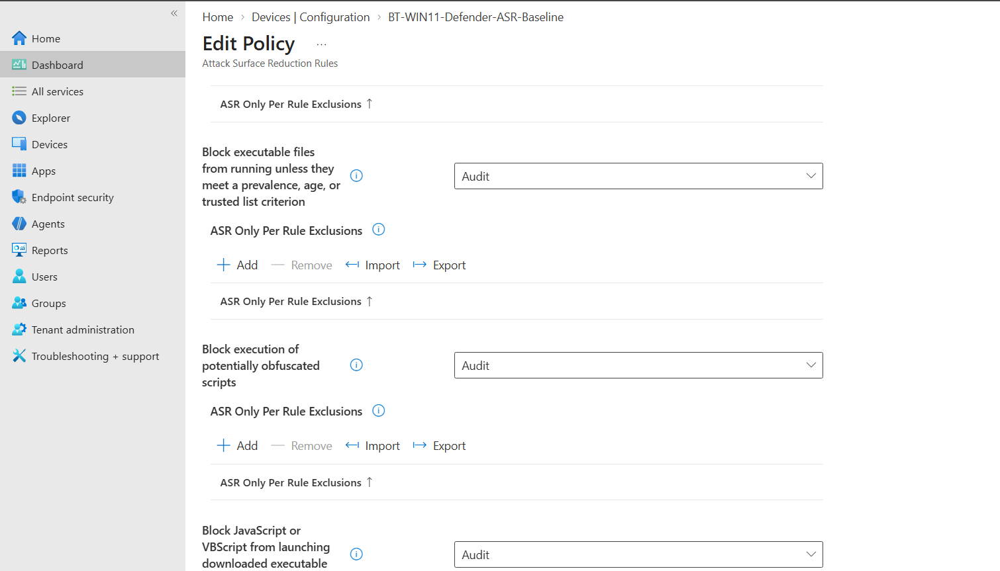

*Script and Office executable creation rules in Audit*

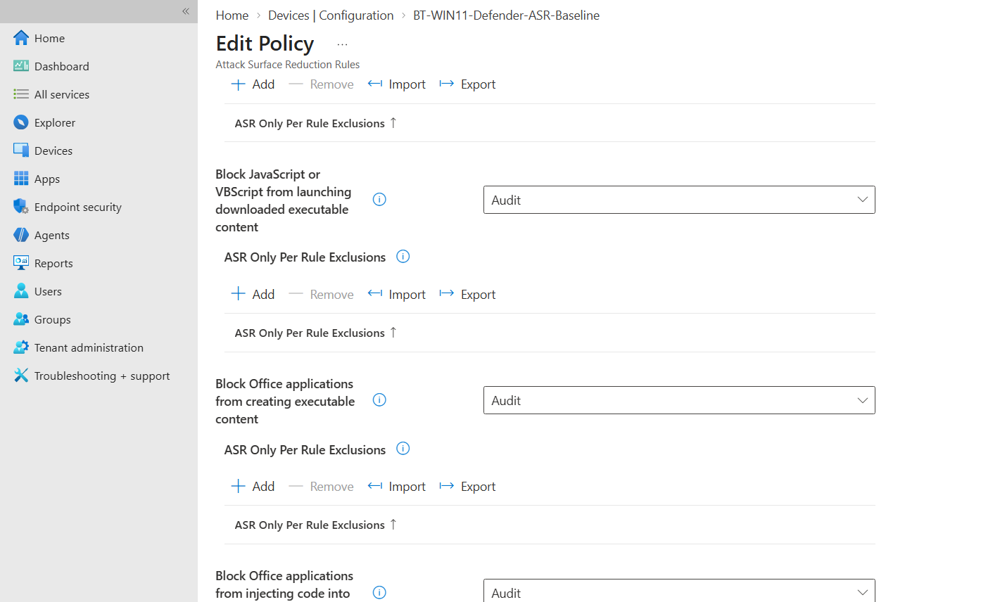

*Office, WMI, and PSExec-related rules in Audit*

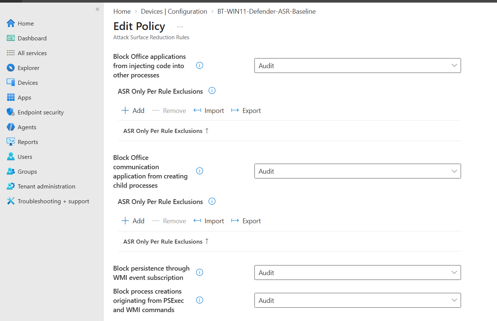

*USB and Office macro rules in Audit*

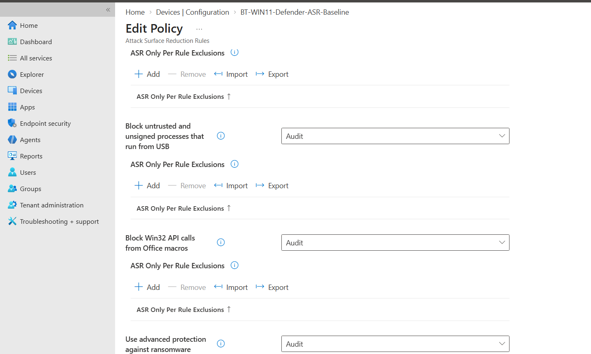

*Ransomware/system tool audit settings; server webshell rule not configured*

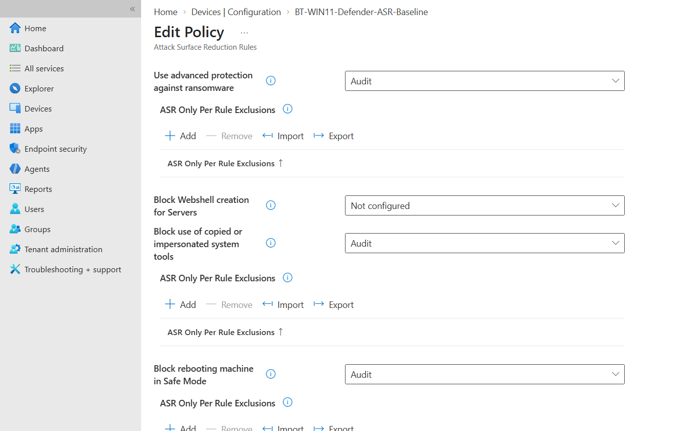

*Controlled Folder Access selected as Audit Mode*

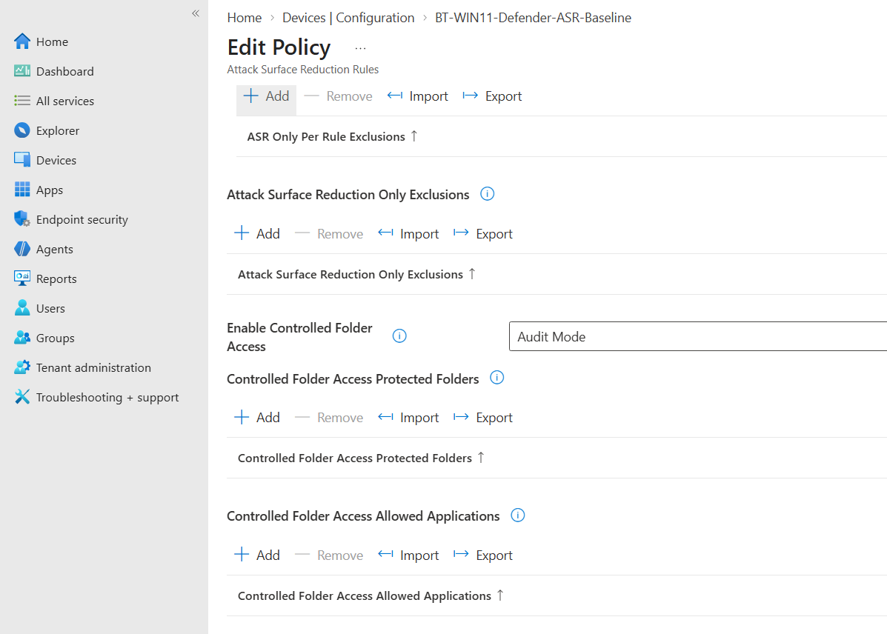

The event screenshot shows a query capped at ten matches (`-MaxEvents 10`); it is a sample, not a total event count or a defined monitoring window. Raw event messages remain excluded. The LSASS rule/process association was reviewed in the private text export and is retained as a documented observation, not an incident conclusion.

## Verification boundaries

Repository validation parses the script without executing security queries and checks Markdown paths and whitespace. Endpoint execution of the new script, recovery testing, enforcement rollout, and remediation of open findings remain unclaimed. The script does not modify policy, sync the device, repair connectivity, escrow keys, or remediate findings.
