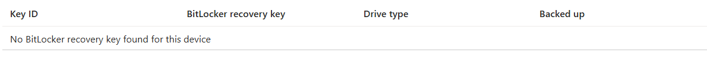
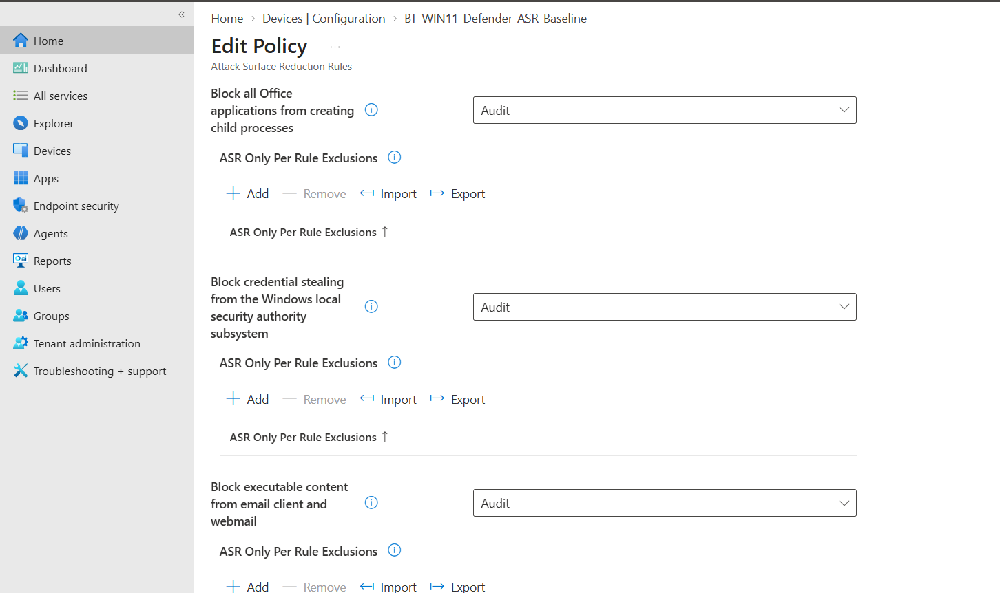
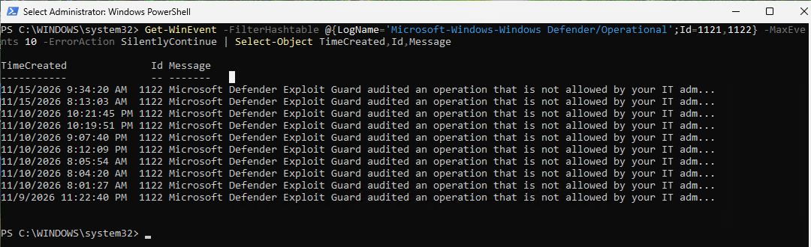

# Security Findings

[Overview](../README.md) · [Remediation tracker](../remediation/README.md) · [Evidence index](EVIDENCE_INDEX.md)

These findings reflect the author's supplied lab observations. Reviewed source artifacts are now published in the evidence index; sensitive raw event logs remain private. No severity score, incident attribution, or remediation completion is inferred.

## BL-01 — Recovery-key visibility

**Status: OPEN**

| Field | Assessment |
| --- | --- |
| Observation | No BitLocker recovery key was found in the Entra portal during review |
| Corroborating local state | C: FullyEncrypted, 100%, Protection On, XtsAes128; TPM and RecoveryPassword protector types present |
| Evidence reference | [BitLocker state](../evidence/06_BitLocker_Encryption_Status.txt), [protector types](../evidence/07_BitLocker_Protector_Types.txt), and cropped portal image below |
| Impact | An unverified recovery path could delay or prevent authorized access if recovery is required |
| Scope limit | The portal observation does **not** establish that recovery material is absent everywhere, that a protector is missing, or that encryption failed |
| Context | MDM-only enrollment; not Entra joined; no root cause established |

*Portal observation supporting BL-01; not proof of absence everywhere*

### Recommended remediation

1. Review the device's enrollment state, intended recovery custody, access permissions, and the supported escrow workflow for that design.
2. Privately determine whether authorized recovery material exists in an approved location. Do not publish keys, identifiers, or key screenshots.
3. If needed, implement an approved recovery/escrow workflow after compatibility review and change planning. Do not assume Entra join or key backup is already configured.
4. Validate authorized retrieval and plan a controlled recovery exercise with safeguards against lockout or data loss.

These are recommendations, not completed actions. Do not force recovery merely to generate portfolio evidence.

### Closure criteria

- The supported recovery custody location and workflow are documented.
- An authorized administrator can retrieve the recovery material associated with the intended device and volume; verification remains private.
- A controlled recovery exercise validates the workflow, or an explicitly approved alternative validation and residual-risk decision is documented.
- A sanitized outcome record supports closure without revealing the recovery password or identifying recovery metadata.

Until these criteria are evidenced, retain **OPEN**. A new successful compliance evaluation alone is insufficient to close BL-01.

## ASR-01 — LSASS protection audit review

**Status: Under Review**

| Field | Assessment |
| --- | --- |
| Observation | Ten recorded Event ID 1122 ASR audit events involved svchost.exe/lsass.exe |
| Rule | LSASS credential protection, `9E6C4E1F-7D60-472F-BA1A-A39EF669E4B2` |
| Configuration context | 18 ASR rules: 1 Block, 17 Audit; Controlled Folder Access Audit; Intune ASR deployment succeeded |
| Block rule | Vulnerable signed drivers, `56a863a9-875e-4185-98a7-b882c64b5ce5` |
| Evidence reference | [ASR settings](../evidence/33_Defender_ASR_Configuration_Verification.txt), policy screenshots, and cropped event sample below; raw event messages excluded |
| Impact | Audit-mode coverage provides visibility but does not demonstrate prevention; enforcement changes may also affect legitimate workflows |
| Evidence limit | No observation window, full event corpus, process validation, or incident investigation supplied |

The events are **audit telemetry, not proof of compromise**. No malicious LSASS access, credential theft, or blocked attack is asserted. Microsoft identifies Event ID 1122 as an [ASR audit event](https://learn.microsoft.com/en-us/defender-endpoint/attack-surface-reduction-windows-events).

*LSASS protection configured in Audit mode*

*Ten returned ASR audit events; query capped at ten, not a total count*

### Recommended remediation and review

1. Review event context privately, including process provenance and legitimate workload behavior; executable names alone are insufficient to classify activity.
2. Establish a documented observation window and assess compatibility impact.
3. Determine whether staged enforcement is appropriate; plan pilot scope, monitoring, rollback, and narrowly justified exceptions if needed. No exceptions are presently documented.
4. Record the approved disposition and validation outcome. Retain unresolved activity for further analysis rather than declaring compromise or benignity without evidence.

### Closure criteria

- Contextual review and an authorized risk disposition are documented.
- The selected enforcement or continued-audit decision has a justification, defined scope, and residual-risk treatment.
- If enforcement is selected, deployment and compatibility results are verified locally and in Intune; no rollout success is assumed.
- If audit mode is retained, risk acceptance, review timing, and monitoring expectations are recorded.
- Sanitized evidence supports the decision; no sensitive raw event logs are uploaded.

ASR-01 remains **Under Review** until a documented decision and its validation exist. Ten audit events alone neither close the finding nor establish an incident.
